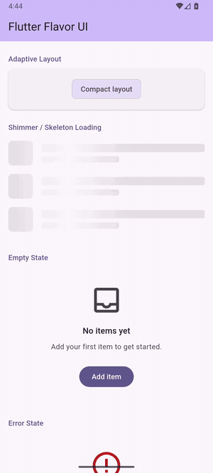

# flutter_flavor_ui

[](https://github.com/hendra-marihot/flutter-ui-toolkit/actions/workflows/ci.yml)
[](LICENSE)

A small widget library for Flutter. No runtime dependencies, Material 3 aware, tested at the lifecycle edges where simple widgets usually break.



## Why

Every Flutter app ends up writing the same widgets: a shimmer loader, an async-safe button, a responsive layout wrapper, an empty state. They look simple, so teams write them inline. The inline versions then collect bugs: animations that break on rebuild, `setState` after dispose, double-tap races. This package is my take on what is worth extracting and how to make the API hard to misuse.

## Widgets

| Widget | Does | Worth noting |
|---|---|---|
| `ShimmerContainer` | Animated shimmer over any widget | Built from `ShaderMask` and `LinearGradient`, no shimmer package. Restarts correctly in `didUpdateWidget` when the duration changes |
| `SkeletonLoader` | Placeholder list with shimmer | Composes `ShimmerContainer`. Default colors come from the theme (`surfaceContainerHighest`). Accepts a custom builder |
| `AsyncButton` | Button that owns its loading state | Ignores taps while loading. Checks `mounted` before `setState`. Errors go to `onError` or `FlutterError.reportError` |
| `AdaptiveLayout` | Layout by breakpoint | Exhaustive Dart 3 `switch` on a `ScreenSize` enum. Falls back to the nearest smaller layout when a size is missing |
| `FlavorValidators` | Composable form validators | Format validators pass on empty input. `required()` is separate, so presence and format are explicit |
| `PullToRefresh` | Pull to refresh with a `canRefresh` switch | Disables the gesture by swapping `notificationPredicate`, so no rebuild and no lost state |
| `EmptyState` | Empty screen with optional action | The button renders only when both label and callback are set |
| `ErrorState` | Error screen with optional retry | Same pattern. The icon uses `colorScheme.error` |

## Install

```bash
flutter pub add flutter_flavor_ui
```

One import gives you every widget:

```dart
import 'package:flutter_flavor_ui/flutter_flavor_ui.dart';
```

## Usage

```dart
// Animated shimmer over any widget.
ShimmerContainer(
  child: Container(width: 200, height: 20, color: Colors.white),
)

// Shimmer placeholder list (defaults to 5 rows).
const SkeletonLoader(itemCount: 8)

// Button that owns its loading state and surfaces errors.
AsyncButton(
  onPressed: () async => submitForm(),
  onError: (error, stackTrace) => reportError(error),
  child: const Text('Submit'),
)

// Responsive layout by breakpoint, with a fallback chain.
AdaptiveLayout(
  compact: const MobileView(),
  medium: const TabletView(),
  expanded: const DesktopView(),
)

// Composable, format-only validators (combine with required()).
TextFormField(
  validator: FlavorValidators.compose([
    FlavorValidators.required(),
    FlavorValidators.email(),
  ]),
)

// Pull-to-refresh with a canRefresh toggle.
PullToRefresh(
  onRefresh: () async => fetchData(),
  child: ListView(/* ... */),
)

// Empty state with an optional call-to-action.
EmptyState(
  title: 'No results found',
  description: 'Try adjusting your search filters.',
  icon: Icons.search_off,
  actionLabel: 'Clear filters',
  onAction: clearFilters,
)

// Error state with an optional retry.
ErrorState(
  message: 'Failed to load data. Please check your connection.',
  onRetry: fetchData,
)
```

## Design decisions

### No runtime dependencies

The only dependency is the Flutter SDK. A UI library sits at the bottom of the dependency graph, and every package it pulls in becomes a version constraint for every app that uses it. Building shimmer from primitives costs more upfront. For a library this size it is the right trade.

### Shimmer from rendering primitives

`ShimmerContainer` is an `AnimationController` driving a `LinearGradient` through a `ShaderMask`. `BlendMode.srcATop` limits the effect to painted pixels. Gradient stops are clamped at the animation edges to avoid artifacts. `didUpdateWidget` restarts the controller when the duration changes, which is what breaks first when a parent rebuilds with new config.

### Validators with explicit empty handling

`email()`, `minLength()` and `numeric()` pass on null and empty input. They check format only. A required email is `compose([required(), email()])`. An optional field that must be a valid email when filled is `email()` alone. The caller states which checks apply, and the optional case stays simple.

### AsyncButton lifecycle

Three things go wrong with a naive async button. A second tap fires a second request. The widget is disposed while the future is in flight and `setState` throws. The future fails and nobody hears about it. `AsyncButton` returns early while loading, checks `mounted` in `finally`, and reports unhandled errors through `FlutterError.reportError`.

## Layout

```
flutter_flavor_ui.dart               ← single barrel export
  └── src/
        ├── adaptive/                 ← responsive layout
        │     ├── adaptive_layout.dart
        │     └── breakpoints.dart
        ├── buttons/                  ← interaction
        │     └── async_button.dart
        ├── feedback/                 ← state feedback
        │     ├── empty_state.dart
        │     └── error_state.dart
        ├── form/                     ← validation
        │     └── validators.dart
        ├── loading/                  ← shimmer & skeleton
        │     ├── shimmer_container.dart
        │     └── skeleton_loader.dart
        └── pull_refresh/             ← gesture
              └── pull_to_refresh.dart
```

This is a package, not an app. There is no `main()` and no platform directory. Every file under `src/` is exported through the barrel, so nothing is public by accident. `FlavorValidators` is an `abstract final class`, `AdaptiveLayout` uses an exhaustive `switch`, and the barrel uses the `library;` directive.

## Out of scope

- State management, routing and navigation
- A theming layer or design tokens. The widgets consume Material 3 themes
- Platform channels. Pure Dart and Flutter
- Complex animation. Only `ShimmerContainer` owns an `AnimationController`

## Tests

68 widget and unit tests. All widget tests run inside a real `MaterialApp` with a theme. Nothing in the framework is mocked.

- **Lifecycle:** `AsyncButton` is disposed mid-flight and tapped twice during loading.
- **Theme:** `SkeletonLoader` tests read the rendered color and compare it to `colorScheme.surfaceContainerHighest`, so dark mode is checked, not assumed.
- **Breakpoints:** `AdaptiveLayout` tests hit 599, 600, 840 and 1200 to catch off-by-one errors.
- **Conditional rendering:** `EmptyState` and `ErrorState` tests count widgets to confirm optional parts are absent, not hidden.
- **Validators:** tested alone and through `compose()`, including the empty pass-through.

Missing: golden tests for the shimmer animation. It is verified structurally, not visually.

## CI

Every push and PR to `main` runs `flutter analyze`, `dart format --set-exit-if-changed .`, `flutter test` and `dart pub publish --dry-run`. All four must pass.

## Known limits

- **No golden tests.** See above.
- **The email regex is practical, not RFC 5322.** It accepts plus-addressing and multi-part TLDs. A spec-complete regex rejects real addresses, so this is the right trade for forms.
- **No extra accessibility work.** The widgets inherit Material semantics. Explicit `Semantics` and screen reader tests are the next step.
- **The example app is a gallery, not a showcase.** It demonstrates every widget without advanced composition or theme switching.

## Run locally

```bash
flutter test
flutter analyze
cd example && flutter run
```

Needs Dart 3.8+ and Flutter 3.27+.

## Related repositories

Each repo in this set covers one area of mobile engineering.

| Repository | Focus |
|---|---|
| [compose-newsreader](https://github.com/hendra-marihot/compose-newsreader) | Multi-module Android, Hilt, Room, offline-first |
| [android-design-system](https://github.com/hendra-marihot/android-design-system) | Compose component library, design tokens |
| [compose-performance-lab](https://github.com/hendra-marihot/compose-performance-lab) | Compose performance anti-patterns and fixes |
| [kmp-currency-converter](https://github.com/hendra-marihot/kmp-currency-converter) | Kotlin Multiplatform, shared business logic |
| [flutter-expense-tracker](https://github.com/hendra-marihot/flutter-expense-tracker) | Clean Architecture, Riverpod, Drift, Material 3 |
| **flutter-ui-toolkit** (this repo) | Reusable widgets, shimmer, adaptive layouts |
| [flutter-platform-bridge](https://github.com/hendra-marihot/flutter-platform-bridge) | Platform channels, native interop |
| [mobile-ci-cd-templates](https://github.com/hendra-marihot/mobile-ci-cd-templates) | CI/CD, release automation |

## License

Copyright 2026 Hendra Marihot. Licensed under the [Apache License 2.0](LICENSE).
